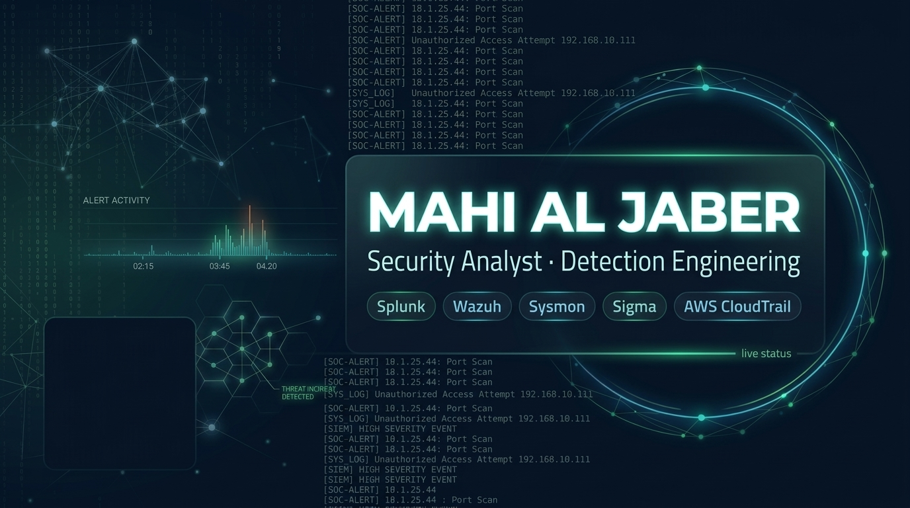

<p align="center">
  
</p>

<h1 align="center">🔓 MiCode</h1>

<p align="center">
  <b>A fast, offline decoder for security analysts — Base64, PowerShell, Base85, Obfuscated URLs &amp; Hex.</b><br>
  Paste a suspicious string → click <b>Decode</b> → read it safely as plain text.
</p>

<p align="center">
  <a href="https://mahialjaber.github.io/MiCode/"></a>
</p>

<p align="center">
  
  
  
  
  <a href="https://github.com/mahialjaber"></a>
</p>

---

## What It Decodes

**MiCode** is a lightweight, zero-clutter alternative to CyberChef built for daily SOC triage and CTF/lab investigations. It **auto-detects** the format or lets you switch modes in one click:

| Mode | Capabilities |
|---|---|
| **Base64 / PS** | Extracts PowerShell `-enc` / `-EncodedCommand` & `FromBase64String()`, decodes UTF-16LE / UTF-8, repairs padding, and auto-decompresses **Gzip / Zlib / Deflate** |
| **Base85** | Decodes **Adobe Ascii85** (`<~…~>`, `z`/`y` shortcuts) and **RFC 1924 / Python `b85encode`** |
| **URL** | Re-fangs `hxxps[:]//` & `[.]`, unwraps multi-layer `%XX`, extracts **SafeLinks** & **Proofpoint** targets, resolves **Hex / Dword / Octal IPs**, and flags `@` phishing tricks |
| **Hex** | Decodes raw/spaced hex dumps, `0x` byte arrays, `\xNN` hex escapes, and `\uNNNN` Unicode escapes |

## 🛡️ Security & OPSEC

- **100% Local & Offline** — Runs entirely in your browser (`connect-src 'none'` CSP). Nothing is ever uploaded or logged.
- **Never Executed** — Output is rendered strictly as plain text, even when decoding active malicious scripts.
- **Honest Diagnostics** — Truncated payloads, binary headers (`MZ`), and URL shorteners are flagged clearly with warnings.

## Run Locally

```bash
git clone https://github.com/mahialjaber/MiCode.git
cd MiCode
python -m http.server 8000   # open http://localhost:8000
```

## ⭐ Support

If **MiCode** helps in your SOC workflow or labs, **star this repository** and follow **[@mahialjaber](https://github.com/mahialjaber)**.

<p align="center">
  <sub><a href="LICENSE">MIT License</a> © <a href="https://github.com/mahialjaber">Mahi Al Jaber</a> · Built for the blue team 🛡️</sub>
</p>
